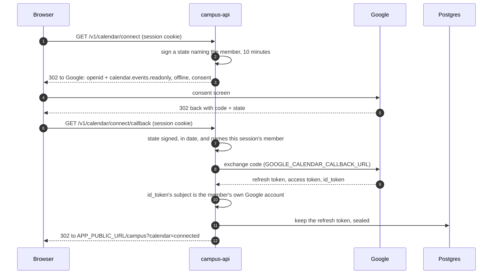

# Google Calendar

A member can connect their own Google Calendar to campus, read-only
(`calendar.events.readonly`), and campus shows them their events, read from
Google each time they ask. Campus never creates or changes an event. The
only copy it keeps is the times of events that carry a room link, synced
from the calendars of people who manage room links (see Sync).

It is an integration of its own, behind `FF_GOOGLE_CALENDAR_ENABLED`.
Sign-in never asks for calendar access, and connecting asks for nothing
else: `openid`, to tell whose calendar it is, and the calendar. So signing
in does not depend on Google verifying the app for a sensitive scope.
Connecting is for full-access sessions only.

## Connecting from the web



Both routes are top-level navigations. Every outcome is a redirect to
`APP_PUBLIC_URL/campus?calendar=<outcome>`, from `CALENDAR_CONNECT_OUTCOMES`
in `calendar-return.ts`:

| Outcome            | Meaning                                                          |
| ------------------ | ---------------------------------------------------------------- |
| `connected`        | Kept.                                                            |
| `invalid_state`    | Not a state campus issued, or issued to somebody else.           |
| `expired_state`    | More than ten minutes since the connection started.              |
| `denied`           | The member cancelled at Google.                                  |
| `missing_code`     | Google returned no code.                                         |
| `exchange_failed`  | Google did not accept the code.                                  |
| `wrong_account`    | Another Google account than the one they sign in to campus with. |
| `not_granted`      | They unticked the calendar.                                      |
| `no_refresh_token` | Google handed over no lasting access.                            |
| `unauthorized`     | No session: the access cookie ran out during the connection.     |
| `not_available`    | The calendar is switched off on this deployment.                 |
| `unavailable`      | Google did not answer in time.                                   |
| `invalid_request`  | The callback's query was malformed.                              |
| `rate_limited`     | Too many requests.                                               |
| `server_error`     | Something failed on campus's side; it is logged.                 |

Sign-in answers a switched-off deployment with a 404. A connection starts
from inside campus, so it gets `not_available` instead of a JSON page.

**Why the callback needs the session.** The state names the member who
started, and the callback refuses one that names somebody else. Otherwise
somebody could start a connection, send a victim the Google link, and end up
holding the victim's calendar on their own account. No extra cookie is
needed, so campus-web's proxy only has to pass the redirects through. The
web app should refresh the session before navigating, so the access cookie
does not run out halfway.

**Why the Google account must match.** The calendar shown is the member's
own: the account they sign in with, which is where invitations to their
address arrive. A grant for any other account is revoked at once, so its
owner is not left with campus on their Google account.

**The id_token's signature is not checked.** It comes straight from
Google's token endpoint over TLS, in answer to this API's client secret,
which OpenID Connect accepts in place of the signature (Core 3.1.3.7). Its
issuer, audience and expiry are checked.

## Connecting from a native app

The app asks Google's SDK for `calendar.events.readonly` and `openid`, with
offline access and force-refresh-token on, for the web client
(`GOOGLE_CLIENT_ID`) as its server client. It posts the server auth code:

```
POST /v1/calendar/connect  { serverAuthCode }   Authorization: Bearer <access token>
```

`204` once kept. `400 INVALID_ARGUMENT` with `details.reason`
(`exchange_failed`, `wrong_account`, `not_granted` or `no_refresh_token`, as
in the table above), or `503` when Google does not answer in time.

## Reading

`GET /v1/calendar/events?from&to` trades the refresh token for an access
token, kept in memory until a minute before it expires, and reads the
primary calendar for that window: by default the coming week, at most 62
days. Recurring events come as one entry per occurrence; cancelled ones are
left out. Campus reads at most four pages of 250 events. A window holding
more answers with the first 1,000 and `truncated: true`.

- No grant: `200 { connected: false, events: [], truncated: false }`.
- Google has withdrawn the grant (`invalid_grant`, or a token that no longer
  covers the scope): the grant is deleted, and the answer is the same.
- Google failing any other way, or taking longer than its timeout: `503`,
  and the grant is kept.

## Rooms

Staff make a room link for an event in the room-links module and paste it
into the Google Calendar event's **location** or **description**:

```
{APP_PUBLIC_URL}/join/{code}
```

A link written another way that opens the same page still counts: `http` or
`https`, with or without `www.`, any case in the host, and percent-encoding
in the path. The code itself is case-sensitive.

The events endpoint looks in the location, then the description, for the
first such link, and resolves every code it found in one lookup through
`RoomLinksService.resolve`, which applies the same rules as opening a link.
An event whose link the member may open carries
`room: { code, cohortId, spaceId, spaceKey, spaceName, title }`; any other
event, and every event when the lookup fails, carries `room: null`. The
video-conference link is not looked at: Google only ever puts a Meet link
there.

## Sync

The calendars of people who manage room links (admins, and live professors
and mentors) are kept in step with `room_link_instances`: one row per run of
an event carrying a room link, with its times and whether it was cancelled.
Nothing else of the event is kept.

- **Which events.** Only those the calendar's owner organised, carrying a
  live link of a cohort they manage. Recurring events are read one instance
  at a time; an instance is keyed by its organiser and Google's event id,
  which stays the same when that one run is moved.
- **Reading.** The first read takes everything from a day ago on and keeps
  Google's sync token; later reads ask only for what changed since. Google
  refusing the token (`410`) means one full read again, and anything held
  that it no longer has is cancelled. Every page is read before any is
  applied, and the rows and the new token are written together.
- **Push.** With `GOOGLE_CALENDAR_WEBHOOK_URL` set, each watched calendar
  has a Google push channel to `POST /v1/calendar/notifications`, renewed a
  day before it lapses. A notification is checked against the channel's id
  and token (kept as a hash) and syncs that calendar.
- **Backstop.** Google drops some notifications, so every watched calendar
  is also synced at least hourly (the `calendar-sync` job, every five
  minutes, takes the 100 synced longest ago).
- **One at a time.** A sync holds a lease on the grant. A change arriving
  meanwhile leaves word, and the holder reads again before letting go.
- **Reconciling.** Google's feed only returns events that changed, so each
  `calendar-sync` run also cancels, across every instance, the runs still to
  come whose link was revoked or whose organiser no longer manages its
  cohort. Past runs are kept.
- **Push is not required.** A channel that cannot be opened is logged, and
  the calendar is synced anyway.
- **Connecting** opens the channel and syncs straight away. Somebody who
  stops managing room links has their channels stopped.

## Talking to Google

Every request the calendar makes to Google, OAuth and Calendar API alike,
goes through `fetchWithTimeout`: one attempt, ten seconds in all, no
retries. `google-auth-library` retries on its own, so the calendar does not
use it. A read of events, which can take a token refresh and four pages, is
held to 20 seconds in all: one deadline every request in it shares.

## Storage

`google_calendar_grants`, one row per account: the refresh token, sealed
with AES-256-GCM under `GOOGLE_CALENDAR_TOKEN_KEY` and bound to the
account's id, so a sealed token copied to another row does not open. A row
that will not open (the key changed) is kept but treated as not connected;
reconnecting overwrites it.

Reconnecting replaces the stored token without revoking the old one: Google
revokes a whole grant at once, so revoking the old token would end the new
one too. For the same reason a reconnect takes back a revocation still
waiting for that member.

## Removing it

A grant is revoked at Google first and its row deleted only once Google
confirms. `revoke_requested_at` marks a grant on its way out. From then on
it is never used. A revocation Google does not confirm, or one whose token
does not open, counts in `revoke_attempts` and waits in `revoke_retry_at`:
ten minutes after the first failure, twice as long after each one after
that, at most a day. Each sweep takes the 100 that are due, those never
tried first, so grants Google keeps refusing do not hold up newer ones.

- **The member:** `DELETE /v1/calendar`. It takes campus off their Google
  account's connections, and works while the calendar is switched off.
- **Access ending:** the sweep marks the grants of suspended accounts, and
  of anybody who is neither an admin nor holds a live membership (they left,
  a guest's visit ran out), then revokes every grant marked. It is a
  scheduled job, every ten minutes. A grant's push channels are stopped
  before it is revoked.
- **Without the right key:** a token that cannot be opened is still live at
  Google, so its grant stays marked, logged as an error at each try, until
  `GOOGLE_CALENDAR_TOKEN_KEY` is right again. With no key set at all, marked
  grants are not tried.
- **The account:** deleting it deletes the grant.
