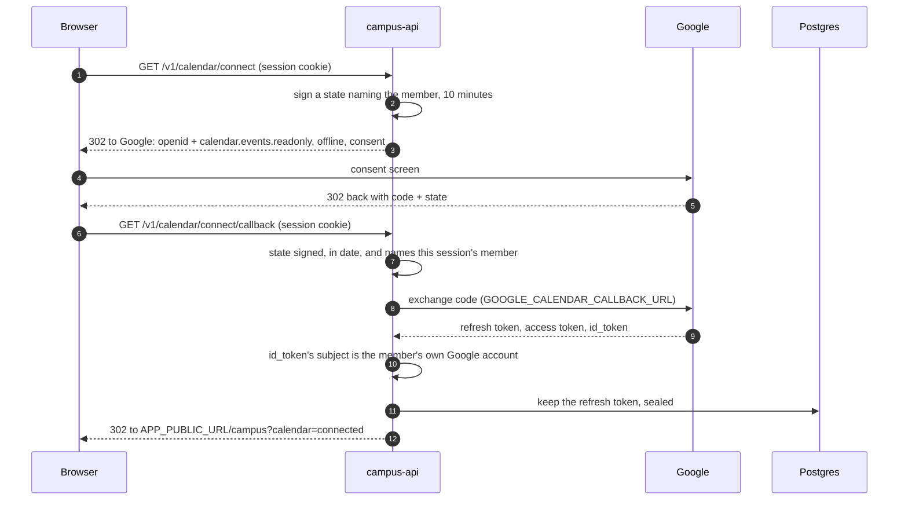

# Google Calendar

A member can connect their own Google Calendar to campus, read-only
(`calendar.events.readonly`), and campus shows them their events. Campus
never creates or changes an event, and keeps no copy of one: events are read
from Google each time the member asks.

It is an integration of its own, behind `FF_GOOGLE_CALENDAR_ENABLED`.
Sign-in never asks for calendar access, so signing in does not depend on
Google verifying the app for a sensitive scope. Connecting is for
full-access sessions only.

## Connecting from the web



Both routes are top-level navigations. Every outcome is a redirect to
`APP_PUBLIC_URL/campus?calendar=<outcome>`:

| Outcome            | Meaning                                                          |
| ------------------ | ---------------------------------------------------------------- |
| `connected`        | Kept.                                                            |
| `denied`           | The member cancelled at Google.                                  |
| `not_granted`      | They unticked the calendar.                                      |
| `wrong_account`    | Another Google account than the one they sign in to campus with. |
| `invalid_state`    | Not a state campus issued, or issued to somebody else.           |
| `expired_state`    | More than ten minutes since the connection started.              |
| `missing_code`     | Google returned no code.                                         |
| `exchange_failed`  | Google did not accept the code.                                  |
| `no_refresh_token` | Google handed over no lasting access.                            |
| `unauthorized`     | No session: the access cookie ran out during the connection.     |
| `not_available`    | The calendar is switched off on this deployment.                 |
| `invalid_request`  | The callback's query was malformed.                              |
| `rate_limited`     | Too many requests.                                               |
| `server_error`     | Something failed on campus's side; it is logged.                 |

**Why the callback needs the session.** The state names the member who
started, and the callback refuses one that names somebody else. Otherwise
somebody could start a connection, send a victim the Google link, and end up
holding the victim's calendar on their own account. No extra cookie is
needed, so campus-web's proxy only has to pass the redirects through. The
web app should refresh the session before navigating, so the access cookie
does not run out halfway.

**Why the Google account must match.** The calendar shown is the member's
own: the account they sign in with, which is where invitations to their
address arrive. A grant for any other account is revoked at once, so its
owner is not left with campus on their Google account.

## Connecting from a native app

The app asks Google's SDK for `calendar.events.readonly` and `openid`, with
offline access and force-refresh-token on, for the web client
(`GOOGLE_CLIENT_ID`) as its server client. It posts the server auth code:

```
POST /v1/calendar/connect  { serverAuthCode }   Authorization: Bearer <access token>
```

`204` once kept. Otherwise `400 INVALID_ARGUMENT` with `details.reason`:
`exchange_failed`, `wrong_account`, `not_granted` or `no_refresh_token`, as
in the table above.

## Reading

`GET /v1/calendar/events?from&to` trades the refresh token for an access
token, kept in memory until a minute before it expires, and reads the
primary calendar for that window: by default the coming week, at most 62
days. Recurring events come as one entry per occurrence; cancelled ones are
left out.

- No grant: `200 { connected: false, events: [] }`.
- Google has withdrawn the grant (`invalid_grant`, or a token that no longer
  covers the scope): the grant is deleted, and the answer is the same.
- Google failing any other way, or taking longer than its timeout: `503`,
  and the grant is kept.

## Storage

`google_calendar_grants`, one row per account: the refresh token, sealed
with AES-256-GCM under `GOOGLE_CALENDAR_TOKEN_KEY` and bound to the
account's id, so a sealed token copied to another row does not open. A row
that will not open (the key changed) is kept but treated as not connected;
reconnecting overwrites it. Reconnecting replaces the stored token without
revoking the old one: Google revokes a whole grant at once, so revoking the
old token would end the new one too.

## Removing it

- **The member:** `DELETE /v1/calendar` deletes the grant and revokes it at
  Google, which also takes campus off their Google account's connections.
  It works while the calendar is switched off.
- **Access ending:** grants of suspended accounts, and of anybody who is
  neither an admin nor holds a live membership (they left, a guest's visit
  ran out), are deleted and revoked. The sweep runs at most every ten
  minutes, on the back of calendar requests. A timer would keep the API
  awake, and it sleeps when idle.
- **The account:** deleting it deletes the grant.
