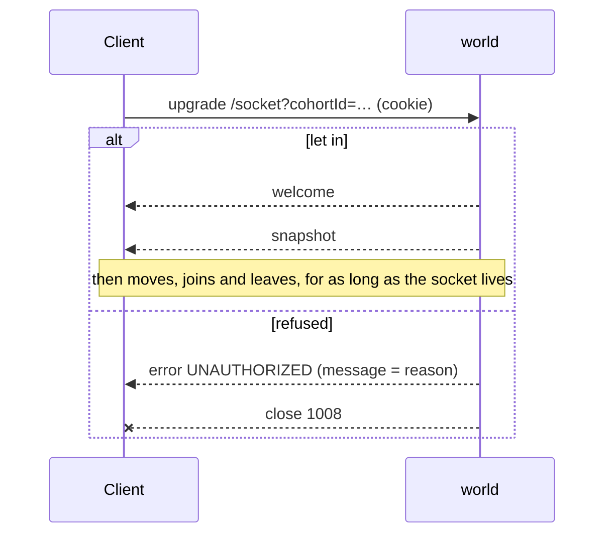

# World protocol

How a client talks to `world`, the realtime service: connecting, moving,
drawing everybody else, and what to do when the socket closes.

The message shapes are not in this document. They live in
[`apps/world/protocol.schema.json`](../apps/world/protocol.schema.json),
generated from the server's code, with a description on every message and
field. Every world instance also serves the one it is running, at
`GET /schema.json`, with no sign-in needed. Generate your types from it
rather than writing them by hand, against whichever environment you build
for:

```sh
curl -s https://ws.dev.campusbyrise.com/schema.json \
  | npx json-schema-to-typescript -o world-protocol.d.ts
```

That emits every type a client needs, with no extra options: the messages
each way (`ClientMessage`, `ServerMessage`) and the close codes and reasons
(`CloseCode`, `CloseReason`). The schema's root is a catalogue of those four,
never a frame itself. A test runs this same generator on the schema.

Each environment serves the protocol of the code deployed there, so one that
is behind another describes the older protocol.

The same instance documents the protocol the way campus-api documents its
routes: a page at `GET /docs`, and behind it the document at `GET /docs-json`.
The document is [AsyncAPI](https://www.asyncapi.com). It holds the same
message shapes and adds what a plain schema cannot say: the socket's address,
how to get in, and which messages a client sends and which it is sent. Read
the page to browse the protocol; give `/docs-json` to anything that reads
AsyncAPI, such as Postman, which can import it and build a WebSocket
collection from it. For generating types, `/schema.json` is the simpler
input.

That gives `ClientMessage`, `ServerMessage`, one type per message
(`MoveMessage`, `MovedMessage`, `MoveResultMessage`, …), and `Player`,
`Avatar`, `Direction`, `MoveOutcome` and `Status`. This document covers what the schema cannot:
the order things happen in, and what the client is expected to do about them.

## Connecting

Open a WebSocket to `/socket?cohortId=<uuid>` on the world service. Every
frame, both ways, is one JSON object with a `type`.

- **Name the cohort you are entering.** `cohortId` is required and there is no
  default: somebody may belong to several, and world will not pick for them.
  Take it from the one the person chose in the picker — `/v1/auth/me` lists
  every cohort they may enter. Leaving it off is refused with `no_cohort`, and
  a cohort they hold no live membership in with `not_a_member`. Admins are the
  exception: their role alone admits them to any cohort, as it does at
  campus-api's sign-in gate.
- **Authentication is the session cookie.** The browser sends
  `campus_session` on the upgrade by itself; the page does nothing. Only a
  `full_access` session gets in — somebody still in onboarding is refused.
- **The page's origin must be in world's `CORS_ORIGINS`.** A WebSocket is not
  covered by CORS, so world checks `Origin` itself and refuses anything not on
  its list.
- **Not a browser?** Send `Authorization: Bearer <token>` and no cookie.

> **World on its own hostname.** Browsers cannot put an `Authorization`
> header on a WebSocket, so the cookie is the only way in, and by default it
> only goes back to the host that set it. Locally that is fine: cookies ignore
> ports, and both services are `localhost`. Deployed, set campus-api's
> `AUTH_COOKIE_DOMAIN` to the parent domain (`campus.example` for a web app on
> `campus.example` and world on `world.campus.example`); the access cookie is
> then sent to world too. The refresh cookie never is.

### What arrives first



- **`welcome`** carries your `userId`, your own `spriteKey` and
  `displayName`, and the timings to play by: `stepMs` (walking speed),
  `tickMs` (how often others' moves arrive), `heartbeatSeconds`, and
  `awayAfterSeconds` (how long before an idle person shows as away; see
  [Status](#status)).
- **`snapshot`** carries which map this is and every player in your cohort
  on it, you included, each with their sprite, name and status. Draw from it;
  everything after is a change to it.

You can send as soon as the socket opens. Frames sent while the server is
still checking the session are held, not lost, and answered in order.

## The map

Positions are **tiles**, never pixels: `x` is the column from 0 at the left,
`y` the row from 0 at the top, so `up` is `y - 1`. The tile's pixel size is
entirely the client's — multiply by it to draw. The server never sees it.

The map is the one published from the Studio, loaded once when the server
starts. `snapshot.map` says which:

```json
{ "id": "campus", "version": "…", "width": 60, "height": 40 }
```

Load **that version**, with `fetchWorldMapManifest({ mapId: id, version })`
from `campus-world-map`, not the current one. A map published since the server
started has walls the server does not enforce, and every step into one would
come back `moved` while you drew it `blocked`, or the other way round. The
server picks up a new version only when it restarts, which closes every socket;
the `snapshot` after you reconnect carries the new version.

A tile is a wall when a collision shape covers its middle: `blocked(layout,
tile)` from the same package gives the answer the server uses, so predict with
it. The map's edge blocks too. `width` and `height` are in tiles.

One map for now, the one people enter the campus on. Portals are read from
it by the client but mean nothing to the server yet.

**Spaces have doors.** Most spaces admit anybody in the campus. A
_designated_ space admits only the people its list names (an admin keeps
the list in campus-api); a step into one you are not on is answered
`refused`, like a wall you cannot see. The corridors and grounds (every tile
in no drawn space) are always open. Only the step _into_ a space is asked
about: somebody already inside stays until they step out, whatever changes
meanwhile. You cannot predict a refusal, so draw the step and let the
`moveResult` correct it. If your saved place is in a space you may no longer
enter, you arrive at the spawn.

In local development only, a server with no published map to load (none
configured, none published, or Sanity out of reach) runs on a placeholder
instead: `id` and `version` are both `"placeholder"`, there is nothing to
load, and only the edge of `width` × `height` blocks.

Two people can stand on the same tile. Nobody blocks anybody.

## Moving yourself

The client says which way, never where to. The server decides every position.

1. **Move at once, then tell the server.** On a key press, draw the step
   straight away and send `{ "type": "move", "direction": "right", "seq": 12 }`.
   `seq` is your own counter; increase it by one per move.
2. **Pace to `stepMs`.** Animate each step over `welcome.stepMs`, and while a
   key is held send the next move when the previous animation ends. Faster
   than that and the server answers `too_fast`. It allows a short burst — a
   few steps delayed by the network and delivered together — but not a
   sustained run.
3. **Every admitted move is answered with a `moveResult`**, in the order sent,
   carrying your `seq` and where the server has you:

   | `outcome`  | Meaning                                                  | What to draw                  |
   | ---------- | -------------------------------------------------------- | ----------------------------- |
   | `moved`    | One tile, as you predicted                               | Nothing changes               |
   | `blocked`  | Not walkable; you turn to face it without moving         | Snap back, facing the new way |
   | `refused`  | Floor, in a space you may not enter; you turn to face it | Snap back, facing the new way |
   | `too_fast` | Over walking speed; nothing happened, not even the turn  | Snap back                     |

4. **Correct against the server, then replay what it has not answered yet.**
   By the time a `moveResult` arrives you may have predicted further steps.
   Throwing those away would jerk the avatar backwards; keeping the prediction
   and ignoring the answer would let the two drift apart. So:

   ```ts
   // `pending`: moves sent and not yet answered, oldest first.
   function onMoveResult(result: MoveResultMessage) {
     pending = pending.filter((move) => move.seq > result.seq);
     me = result.player;
     for (const move of pending) {
       me = predictStep(me, move.direction); // your own step, edge check included
     }
   }
   ```

   When every prediction was right — nearly always — this changes nothing on
   screen.

## Everybody else

**Everybody else means everybody in your cohort.** Each cohort is its own
campus: the cohort named when the socket opened decides whose avatars you are
told about, and nobody in another cohort appears in your `snapshot`, `joined`,
`left`, `moved`, `statusChanged` or `spaceChanged`, or you in theirs.

| Message         | When                                              | What to do                                         |
| --------------- | ------------------------------------------------- | -------------------------------------------------- |
| `joined`        | Somebody arrived                                  | Add their avatar, with its sprite, name and status |
| `appearance`    | Somebody changed their sprite or name             | Redraw them with it                                |
| `statusChanged` | Somebody's status changed, yours included         | Show their new status                              |
| `spaceChanged`  | Somebody stepped into another space, you included | Move them to that space in your sidebar            |
| `left`          | Somebody's socket in this cohort closed           | Remove their avatar                                |
| `moved`         | Once per tick, if anybody moved or turned         | Move each listed player                            |

About `moved`:

- **One entry per person, as they stand now.** Two steps inside one tick
  arrive as the second, so an entry can be **more than one tile** from where
  you last drew them. Walk the gap one tile at a time rather than sliding
  diagonally — a diagonal slide cuts corners that will be walls once real
  maps exist.
- **You are never in your own `moved` frame** — your `moveResult` already says
  where you ended up.

### Drawing each person

Somebody first appears as an `Avatar` — in the `snapshot`, or in `joined` —
which is a `Player` plus four fields saying what to draw:

- **`spriteKey`**: which character. One of the keys campus-api accepts on
  `PATCH /v1/users/me` (listed in its API docs), or `null` when the person has
  picked none or picked one that is no longer offered. Draw your default for
  `null`, and for any key you have no sprite for yet.
- **`displayName`**: the name to show beside them, or `null` when they have
  set none.
- **`status`**: `available`, `busy` or `away`, as it is now. Unlike the other
  two it changes while they are here; see [Status](#status).
- **`spaceKey`**: the space they are standing in, a drawn space's key or
  `_default` for the corridors and grounds. A `spaceChanged`
  (`{ "type": "spaceChanged", "userId": "…", "spaceKey": "library" }`) follows
  every step into another space, the moment it is taken, so it can arrive
  before the `moved` that shows the step.

Keep all four by `userId`. `moved` and `moveResult` carry a plain `Player` —
position and facing only — so take what to draw from the `Avatar` and keep it
until that person's `left`, or until an `appearance`, a `statusChanged` or a
`spaceChanged` replaces part of it.

**The sidebar.** Who is online in this cohort is who the socket has told you
about: the `snapshot`, then `joined` and `left`. campus-api's
`GET /v1/cohorts/{id}/profiles` lists everybody in the cohort with their name
and sprite; anybody it lists that the socket has not is offline. Group people
by `spaceKey` where two or more share one. An admin can be on the map without
a membership, so the socket may tell you of somebody the list does not have:
show them from their `Avatar`. Read the list again whenever the socket
connects or reconnects, and when `joined` names somebody it does not have:
that is how a new member appears. Somebody offline who changes their name or
sprite shows the change when they next arrive, since their `Avatar` carries
it.

**A change shows straight away.** When somebody saves a new sprite or display
name, everybody in their cohort, themselves included, gets:

```json
{
  "type": "appearance",
  "userId": "…",
  "displayName": "Ada L.",
  "spriteKey": "placeholder-4"
}
```

Redraw that person with it. Nothing is sent when what to draw did not change.
campus-api tells world as it saves; should that notice be lost, world still
picks the change up within one heartbeat.

## Status

Everybody is **available**, **busy** or **away**, and everybody in their
cohort sees which: `Avatar.status` says what it is when they appear, and a
`statusChanged` follows every change after.

- **Choosing.** Send `{ "type": "setStatus", "status": "busy" }`. When that
  changes what the cohort sees, everybody in it gets
  `{ "type": "statusChanged", "userId": "…", "status": "busy" }` — you too,
  which is your confirmation. Choosing what you already show sends nothing
  back, so draw your own choice at once rather than waiting for an answer.
- **Away while idle.** Somebody who does nothing for
  `welcome.awayAfterSeconds` (600, ten minutes, by default) is shown as away,
  and is sent the `statusChanged` saying so like everybody else. The first
  thing they do afterwards brings back the status they had chosen, with
  another `statusChanged`. The server notices at its heartbeat, so going away
  can land up to `heartbeatSeconds` late; coming back is immediate. An away
  they chose themselves is theirs: activity does not clear it, only choosing
  another status does. `awayAfterSeconds` is `0` on a deployment that never
  does this.
- **What counts as doing something:** a `move`, a `setStatus`, and `active`.
  The server sees nothing else — not somebody reading the map, typing
  elsewhere in the app, or talking on a call — so send `{ "type": "active" }`
  when the person presses a key, clicks or moves the pointer. Throttle it to
  a small fraction of `awayAfterSeconds`: once a minute suits the default,
  often enough never to be taken for idle, rarely enough to cost nothing. It
  has no answer. A `ping` does not count: it is the client's, not the
  person's.
- **It lasts as long as the connection.** Nothing is saved. A socket that
  closes takes the status with it, and the next one starts available — a
  reconnect within the grace included. Another tab in the same cohort is the
  exception: the avatar never left, so the new tab keeps the status chosen in
  the old one. If the old tab had gone idle, the new one brings them back, and
  the rest of the cohort gets a `statusChanged`; the new tab reads it from its
  `snapshot`.
- **One status per cohort,** as there is one avatar per cohort. Somebody in
  two cohorts' campuses at once chooses, and goes idle, in each separately.

## Calls

Every space has an audio call per cohort. World hands you the one for the
space you stand in; you join it with a LiveKit client.

- **`call`** arrives after the `snapshot`, and again each time you step into
  another space: leave the call you are in and join this one, with
  `call.url` and `call.token`. `null` means there is no call where you
  stand. World also takes you out of the old call itself, so a client that
  stays is removed. A new `call` can also come without a step, when the
  space's call changes (its row appears, or its hearing or radii change).
  World restarting leaves you in your call; the `call` you get after
  reconnecting replaces it.
- **`call.hearing`** says whom to listen to:
  - `room`: everybody in it. Subscribe to every participant.
  - `proximity`: only the people the latest **`nearby`** names
    (`{ "type": "nearby", "userIds": ["…"] }`). Turn auto-subscribe off,
    subscribe to theirs, and drop everybody else's. Fade each voice by
    distance, from full at your tile to nothing at `call.audibleRadius`
    tiles, using the positions you already draw. `nearby` comes whenever
    the list changes, and can arrive before the `call` it belongs to: keep
    the latest. Stepping out of a proximity space sends an empty one.
- **A participant's identity** is their user id, a colon, and a suffix that
  changes each time they join. Match it to `nearby` and to avatars by the
  part before the colon.
- Nobody hears across a space's edge: everybody in a call is in that space.

## One connection per cohort

**An account has one connection in each cohort's campus.** Somebody who
belongs to several cohorts can be in all of them at once, with an avatar in
each: everybody in each cohort sees them there, and online means online in
that cohort.

- **Entering another cohort** leaves the first exactly as it was. Nobody is
  replaced, and nobody in the first cohort sees them leave. The new cohort
  sees `joined`, at where they last stood there, or at the spawn.
- **Entering the same cohort again**, from another tab or device, takes the
  first connection's place. The avatar stays exactly where it stood, with the
  status chosen there, and nobody is told anybody left or arrived. World sends the displaced connection
  `{ "type": "replaced" }` and closes it with **4000 `entered_elsewhere`**.

Other pages are unaffected. The cohort picker, a profile screen and an invite
screen hold no socket, so they keep working in as many tabs as you like.

> **Do not reconnect on `entered_elsewhere`.** This is the one close the
> client must not retry. Two tabs on the same cohort that both reconnected
> would replace each other for as long as both stayed open, and neither would
> be usable. Show **"You opened this campus somewhere else"** with an
> **"Enter here"** button, and reconnect only when the person presses it.

## Limits

- **Messages:** about `WORLD_MAX_MESSAGES_PER_SECOND` (20 by default) per
  socket, with a second's worth allowed at once, whatever the frames are —
  `setStatus` and `active` included. Walking at full speed while pinging uses
  about half. The first frame past the budget closes the socket
  with `rate_limited` before parsing. Reconnect and rebuild state from the
  fresh snapshot.
- **Frame size:** 16 KB by default. Larger closes the socket with 1009.
- **Reading:** a client that stops reading what it is sent — a frozen tab, a
  debugger paused on a breakpoint — is disconnected once about 1 MB is waiting
  for it, rather than skipped: skipped frames would leave it believing people
  stand where they no longer do. It sees a 1006 and reconnects to a fresh
  snapshot.

## Staying connected

The server pings every `heartbeatSeconds` and drops a socket that has not
answered by the next ping. Browsers answer these pings themselves; there is
nothing to write. The `ping` message exists for clients that want to measure
round-trip time, and gets a `pong`.

**Keep the sign-in refreshed.** The socket does not end when the access token
it opened with expires; it stays while the sign-in behind it is live — not
signed out, and refreshed through `POST /v1/auth/refresh` within the last 20
minutes. So refresh ahead of time — a minute before the `expiresAt` that
each refresh (and `GET /v1/auth/me`) returns — even while the user is only
standing in the world and making no other calls.
Refreshing only after an API call fails would let the socket close with
`session_ended` during a quiet stretch. See
[auth-flow.md](./auth-flow.md#how-world-follows-a-sign-in).

**A visit can run out too.** The cohort membership the socket named is asked
again at every heartbeat, so a guest whose visit ends while they are in the
world is closed with `not_a_member` at the next one — the same reason an
upgrade into that cohort would now be refused. Admins are excepted, as at the
upgrade.

## Errors and closing

An `error` with code `BAD_MESSAGE` means the frame was not valid JSON or not a
message the server knows. The socket stays open. Seeing one means a client
bug, so log it.

When the socket closes:

Both lists are in `/schema.json`, as `CloseCode` and `CloseReason`, each value
described with what to do. Generate them with the rest of the protocol rather
than copying this table: a reason renamed or added then fails the client's
typecheck instead of shipping unnoticed. A test keeps this table and the code
in step.

| Code | Reason                 | Meaning                                                                                     | What to do                                                                                       |
| ---- | ---------------------- | ------------------------------------------------------------------------------------------- | ------------------------------------------------------------------------------------------------ |
| 1008 | `no_token`             | No session was sent.                                                                        | Send them to sign in.                                                                            |
| 1008 | `token_not_usable`     | The session sent is not usable: expired, or signed before a change to what a token carries. | Try a refresh; if that fails, send them to sign in.                                              |
| 1008 | `session_expired`      | The access token an open socket opened with ran out, and it follows no sign-in.             | Try a refresh; if that fails, send them to sign in.                                              |
| 1008 | `session_ended`        | Signed out, or the sign-in stopped being refreshed.                                         | Try a refresh; if that fails, send them to sign in.                                              |
| 1008 | `session_revoked`      | The account's sessions were ended on purpose.                                               | Send them to sign in; a refresh will not work.                                                   |
| 1008 | `wrong_scope`          | Still in onboarding.                                                                        | Send them to onboarding.                                                                         |
| 1008 | `account_suspended`    | The account is suspended.                                                                   | Sign them out; do not reconnect.                                                                 |
| 1008 | `account_gone`         | The account no longer exists.                                                               | Sign them out; do not reconnect.                                                                 |
| 1008 | `origin_not_allowed`   | This page's origin is not on world's list.                                                  | Configuration; do not retry.                                                                     |
| 1008 | `no_cohort`            | The upgrade named no cohortId.                                                              | Client bug; do not retry without one.                                                            |
| 1008 | `not_a_member`         | No live membership in the cohort named; admins excepted.                                    | Back to the cohort picker; do not retry.                                                         |
| 1008 | `rate_limited`         | Sustained sending over the message budget.                                                  | Client bug; reconnect with backoff.                                                              |
| 4000 | `entered_elsewhere`    | This account opened this cohort's campus somewhere else.                                    | Do not reconnect: show that they are in this campus elsewhere, and reconnect only when they ask. |
| 1001 | `server shutting down` | A deploy or restart.                                                                        | Reconnect.                                                                                       |
| 1011 | `internal_error`       | The server could not check the session.                                                     | Reconnect with backoff.                                                                          |
| 1009 | —                      | A frame over the size limit (16 KB by default)                                              | Client bug; reconnect                                                                            |
| 1006 | —                      | Connection lost, a missed heartbeat, or not reading fast enough                             | Reconnect with backoff                                                                           |

When the connection is refused at the start, an `error` frame with the same
reason as its `message` arrives just before the close. A socket closed later
— `session_ended`, `session_expired`, `session_revoked`, `not_a_member`, or
a suspension that reaches an open socket — gets the close alone, so read the
reason from the close event, not from an `error`.

**A reconnect resumes where you stood** if it comes within
`WORLD_RECONNECT_GRACE_SECONDS` (30 by default) of your socket closing.
That covers a network blip, the server's own cut-offs — `rate_limited`, a
missed heartbeat, not reading fast enough — and `session_ended`,
`session_expired` or `session_revoked`: signing straight back in resumes too, since a sign-in
ending is routine rather than access being taken away. Past the grace, or
after a server restart, you start where you last stood in that cohort on an
earlier visit — world keeps a position per cohort — or at the spawn if nothing
is kept, the tile is no longer walkable, or it was more than 90 days ago. So
never assume an arrival is at the spawn: read your position from the
`snapshot`.

A suspension or a removed account forgets the position as soon as world
notices: at its next check of open sockets, or when a reconnect is refused
for it. Only the cohorts involved are forgotten — the one an open socket
stood in, and the one a refused attempt named; a position for any other
cohort is left alone. If a suspension is lifted before any of that happens,
the person was never refused and resumes as normal.

Either way, take your position from the new `snapshot`, never from what you
drew before the drop, and throw away any moves still pending: they were
answered, or not, on the old socket.

Others see you leave straight away and arrive again when you return. There
is no frozen stand-in while you are gone — somebody who closed the tab should
not linger on everybody's screen for the length of the grace.

## Changing the protocol

For whoever edits the server:

1. Change the schemas in `apps/world/src/socket/protocol.ts`, with a
   description on anything new.
2. Run `pnpm --filter world protocol:schema` and commit the regenerated
   `protocol.schema.json`. CI fails if you forget.
3. Update this document if what a client should _do_ changed.
4. Tell the frontend: they regenerate their types once it is deployed, from
   that environment's `/schema.json`.
